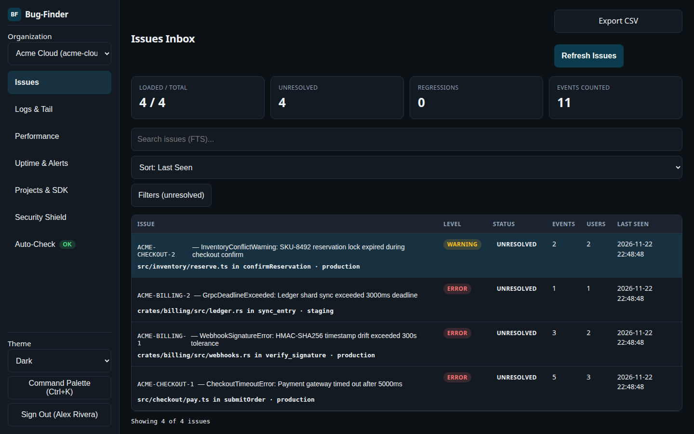
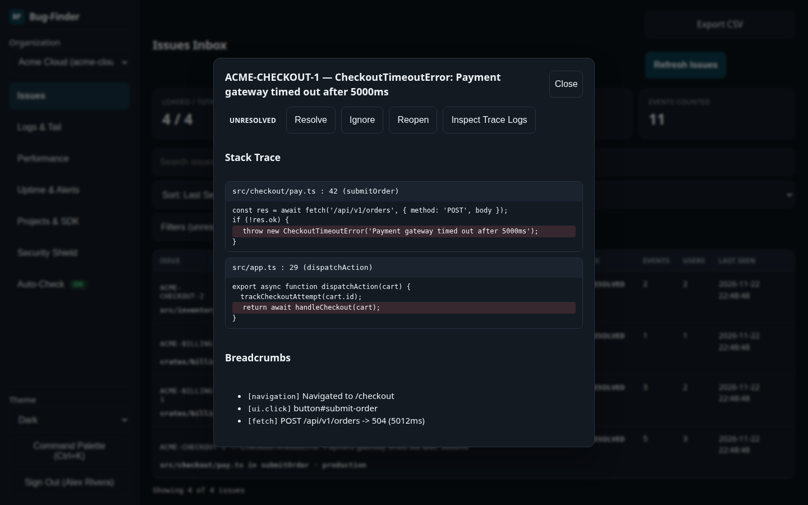
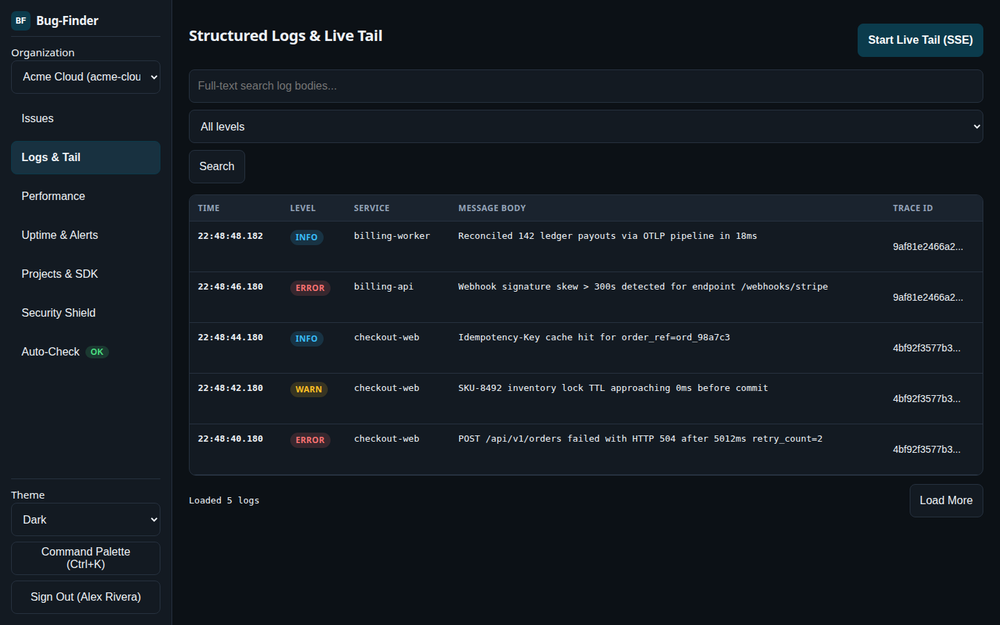
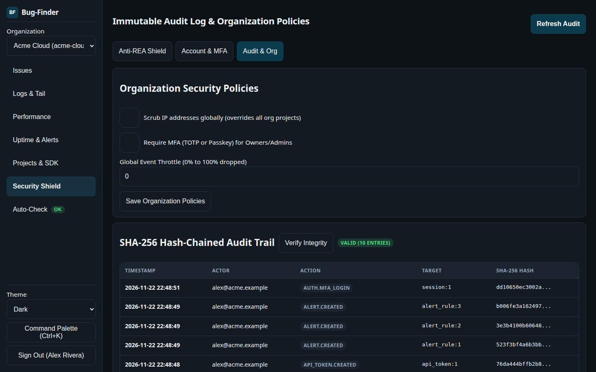

# Bug-Finder

[](Cargo.toml)
[](#measured-benchmarks)
[](#quickstart)
[](SECURITY.md)
[](#connect-any-app-in-one-ai-prompt)
[](docs/ENDPOINTS_AND_SECURITY.md)
[](LICENSE)

**Self-hosted error tracking, live logs, uptime alerts, and built-in web attack protection in one tiny Rust binary.**

Bug-Finder catches crashes across your frontend and backend, streams structured logs in real time, monitors cron jobs and APIs, and blocks common web attacks from a single **~6.5 MB** executable using **~10 MB of RAM**. It works as a drop-in backend for existing **Sentry**, **GlitchTip**, and **OpenTelemetry (OTLP)** SDKs, with zero Python, no Redis, and no background worker fleet to maintain.



---

## What You Get Out of the Box

- **Error Tracking & Private SourceMaps**: Group identical crashes automatically, detect regressions after deploys, view click/network breadcrumbs, and demangle minified JavaScript stack traces privately without exposing `.js.map` files to the public.
- **Live Logs & Distributed Traces**: Search structured logs with full-text search (FTS5), watch live traffic via Server-Sent Events (SSE), ingest OpenTelemetry `/v1/logs`, `/v1/traces`, and `/v1/metrics`, or stream terminal output directly with `bugfinder wrap` and `bugfinder pipe`.
- **Built-In Edge WAF & Security Shield**: Inspect incoming requests in under `1 us` with a Rust SIMD firewall that blocks SQL injection, path traversal, XSS, cloud metadata SSRF, command injection, and dotfile probes (`/.env`, `/.git`), plus automatic secret-leak detection and CGNAT-safe quarantine.
- **Uptime Heartbeats & Multi-Channel Alerts**: Track scheduled jobs and health pings, and receive instant alerts on Slack, Discord, Telegram, Email (native TLS SMTP), or HMAC-signed Webhooks.
- **1-Prompt AI Setup & Verification Shell**: Copy one auto-generated prompt from the dashboard or `bugfinder ai-prompt` (also published at `GET /llms.txt`) so your AI coding assistant wires every endpoint for you, then verify all 7 integration layers in `< 250 ms` with `bugfinder check`.
- **Enterprise Security by Default**: Runs on embedded SQLite WAL or PostgreSQL 17 with `ENABLE + FORCE ROW LEVEL SECURITY` across all 15 tables, `enc:v2:` AES-256-GCM secret encryption with key rotation, TOTP 2FA, WebAuthn Passkeys with step-up re-auth, OIDC SSO, an immutable SHA-256 audit log, and `0` active CVEs verified on every CI run.

---

## Visual Tour

### 1. Stack Traces, Source Context & Breadcrumbs
Inspect demangled source lines, exact function frames, and the user clicks or failed API calls leading up to every crash.



### 2. Structured Logs & Real-Time Live Tail
Filter logs by severity, service, or full-text search, jump directly to correlated `trace_id` entries, or stream live events with SSE.



### 3. Uptime Heartbeats & Multi-Channel Alerts
Monitor recurring workers and endpoints alongside alert rules for Slack, Discord, Telegram, SMTP email, and signed webhooks.


### 4. Guided App Connection & 1-Prompt AI Setup
Copy a single CSP-compatible HTML script tag, run `bugfinder init`, or grab a complete AI auto-setup prompt with live connection verification.


### 5. Security Shield, Edge WAF & Secret Leak Radar
Review blocked attacks, secret-leak alerts, and active CGNAT-safe quarantines with one-click release controls.


### 6. Immutable Audit Log, 2FA & Passkeys
Enforce organization-wide IP scrubbing and admin MFA policies backed by a tamper-evident SHA-256 hash-chained audit trail.



### 7. Built-In Auto-Check & Self-Diagnostics
Check storage health, disk budget, live RAM usage, ingestion queue depth, and end-to-end telemetry delivery directly from the UI.


### 8. Responsive Mobile Dashboard
Triage issues, check regressions, and monitor alerts from a phone with touch-friendly navigation.


---

## Quickstart

### Option 1: One-Command Installer (Linux Binary, `systemd`, or Docker)

```bash
./scripts/install.sh            # Installs ~/.local/bin/bugfinder + 0600 .env + runs doctor
./scripts/install.sh --service  # Installs an auto-starting user systemd service
./scripts/install.sh --docker   # Starts the hardened Docker Compose stack
```

### Option 2: Hardened Docker Compose (`128 MB` RAM Cap, Read-Only Rootfs)

```bash
docker compose up -d --build
```

`compose.yml` runs Bug-Finder with `mem_limit: 128m`, `read_only: true`, `cap_drop: [ALL]`, `no-new-privileges:true`, and `pids_limit: 64`.

### Option 3: Build from Source

```bash
./scripts/build-release.sh
./target/release/bugfinder --headless --bind 127.0.0.1:8080 --data ./data
```

Replace `--headless` with `--app` to launch Bug-Finder as a local desktop window.

---

## Connect Any App in One AI Prompt

Bug-Finder exposes `GET /llms.txt` publicly (zero cookies) and `GET /api/0/projects/:org/:proj/ai-blueprint/` per project so an AI coding assistant can wire your app end to end:

```bash
# 1. Generate a stack-aware setup prompt containing all endpoints for your project:
bugfinder ai-prompt \
  --dsn "https://<PUBLIC_KEY>@bugs.example.com/1" \
  --app-url "https://app.example.com" \
  --dir .

# 2. Paste the prompt into your AI assistant to configure the SDK, proxy routes,
#    WAF blocklist sync, private SourceMaps, structured logs, and MCP server.

# 3. Verify all 7 integration and security layers in < 250 ms (creates zero test issues):
bugfinder check \
  --dsn "https://<PUBLIC_KEY>@bugs.example.com/1" \
  --app-url "https://app.example.com"

# Or run the auto-.env shell wrapper:
./scripts/check.sh --app-url "https://app.example.com"
```

### Endpoints Covered Automatically

| Purpose | Method & Path | Notes |
|---|---|---|
| Health & AI Spec | `GET /api/health`, `GET /llms.txt` | Cookie-free, strict security headers |
| Browser Mini-SDK | `GET /sdk/bugfinder-mini.js` | Pre-wire URL secret scrubbing, `Request` header cloning, optional same-origin `traceparent` |
| Anti-REA Shield SDK | `GET /sdk/bugfinder-shield.js` | CDP/WebDriver/tamper detection (`detect` / `defend` / `lockdown`) |
| Error & Session Ingest | `POST /api/:id/envelope/`, `POST /api/:id/store/` | Supports `X-BugFinder-Check: dry-probe` and timestamp skew clamping |
| Anti-AdBlock Tunnel | `POST /t/:slug` | Reverse-proxied via `/_obs/e` on the monitored app |
| Logs, Traces & Metrics | `POST /api/:id/otlp/v1/logs`, `POST /v1/logs`, `POST /v1/traces`, `POST /v1/metrics`, `POST /api/v1/logs` | OTLP JSON/Protobuf and direct JSON |
| CSP & Shield Telemetry | `POST /api/:id/security/`, `POST /api/:id/shield/` | Browser session quarantine or server `Bearer bf_...` IP quarantine |
| Edge Blocklist Sync | `GET /api/0/projects/:org/:proj/shield/blocklist/` | Cached via `ETag` (`304 Not Modified`), exposes per-project HMAC key |
| Private SourceMaps | `POST /api/0/projects/:org/:proj/releases/:version/sourcemaps/` | Zero public `.js.map` exposure |

---

## Measured Benchmarks

Measured on a single `Ubuntu 24.04 Linux x86_64` host (12 threads, `postgres:17-alpine`) using a 1.53 KB Sentry envelope across 50 rotating fingerprints (3 stack frames, 5 breadcrumbs):

| Metric | Bug-Finder (SQLite WAL) | Bug-Finder (PG17 `FORCE RLS`) | GlitchTip 7.0.0 (PG17, No-Valkey) |
|---|---|---|---|
| **Binary / Container Size** | **~6.5 MB single binary** | ~6.5 MB binary + PG | 953 MB app image + PG |
| **Idle App RAM (`VmRSS`)** | **8.8 – 9.6 MiB** | **9.5 MiB** | 162.3 MiB |
| **Total Stack RAM Post-Load (App + DB)** | **14.3 MiB** | **71.8 MiB** | 379.7 MiB |
| **Cold Start to HTTP `200 /api/health`** | **18.7 – 21.0 ms** | **56.7 ms** (`SKIP_MIGRATIONS=1`) | 5,114 ms *(excl. 22.1 s init)* |
| **Sequential Ingest (`100 x 1`)** | **907.9 req/s** (`p50 = 1.04 ms`) | **892.8 req/s** (`p50 = 1.12 ms`) | 203.9 req/s (`p50 = 4.88 ms`) |
| **Burst Ingest (`1,000 x 16` threads)** | **2,248 – 2,421 req/s** (`p50 = 5.8 ms`) | **2,208.9 req/s** (`p50 = 6.08 ms`) | 517.5 req/s (`p50 = 29.14 ms`) |
| **Issues List API Read (`200 x 8` threads)** | **2,020.3 req/s** (`p50 = 3.50 ms`) | **1,979.1 req/s** (`p50 = 3.62 ms`) | 9.7 req/s (`p50 = 725.5 ms`) |
| **Security Invariant Linter** | **< 3 ms** (`bugfinder lint`, 0 Python) | **< 3 ms** (`bugfinder lint`) | External scripts |

> **When to choose GlitchTip vs Bug-Finder:** Pick **GlitchTip** if you need native C/C++/Rust minidump (`difs`) symbolication or S3/Parquet cold storage. Pick **Bug-Finder** for a **~10 MiB** single-binary footprint, **sub-25 ms** cold starts, strict PostgreSQL `FORCE RLS`, immutable audit logs, and a built-in Rust Edge WAF without running Django, workers, or Redis.

---

## Documentation

- [Architecture & Performance Pipeline](docs/ARCHITECTURE.md): Adaptive `BatchWriter`, 16-shard `ShardedBoundedMap`, SIMD `AhoCorasick` WAF and Scrubber, SQLite WAL `mmap`, and PostgreSQL 17 `FORCE RLS`.
- [1-Prompt Autonomous AI Integration & MCP](docs/AI_INTEGRATION.md): `/llms.txt`, `ai-blueprint`, `bugfinder ai-prompt`, stealth proxy routes, and read-only STDIO MCP tools.
- [Endpoints & End-to-End Security](docs/ENDPOINTS_AND_SECURITY.md): Complete endpoint map, browser pre-wire scrubbing, RFC 9113 multi-header parsing, Passkey step-up re-auth, `enc:v2:` key rotation, and `v2` anti-replay webhooks.
- [CLI Reference & 7-Layer Verification Shell](docs/CLI_AND_CHECK_SHELL.md): All 19 CLI subcommands plus `bugfinder check` and `./scripts/check.sh`.
- [Security Policy](SECURITY.md): Vulnerability disclosure process, supported versions, and supply-chain guarantees.

---

## Environment Variables Reference

| Variable | Default | Description |
|---|---|---|
| `BUGFINDER_BIND` | `127.0.0.1:8080` | Bind `ip:port` (`127.0.0.1:0` in `--app` mode). |
| `BUGFINDER_DATA_DIR` | `./data` | Data directory (`0700`) for SQLite DB, `.app_key` (`0600`), and private SourceMaps. |
| `DATABASE_URL` | *(SQLite)* | Optional `postgres://...` / `postgresql://...` or `sqlite://...` URI. |
| `BUGFINDER_APP_KEY` | *(auto `.app_key`)* | 64-char hex master key (generate via `bugfinder keygen`). |
| `BUGFINDER_PREVIOUS_APP_KEYS` | *(empty)* | Comma-separated retired 64-char hex keys for zero-downtime `enc:v2:` / `enc:v1:` secret decryption during rotation. |
| `BUGFINDER_ENV` | `production` (`dev` only when explicitly set) | Set `production` (default fail-closed) or `dev`/`development` for local HTTP development. |
| `BUGFINDER_PUBLIC_URL` | *(unset)* | Canonical public HTTPS origin for blueprints, Connect App, and OIDC callbacks. |
| `BUGFINDER_ALLOWED_HOSTS` | *(empty)* | Comma-separated allowed `Host` headers (wildcard `*` rejected). |
| `BUGFINDER_TRUSTED_PROXIES` | *(empty)* | Comma-separated CIDRs/IPs or presets `loopback`, `private`, `cloudflare` (no `*`). |
| `BUGFINDER_FORCE_SECURE_COOKIES` | `false` | Set `1`/`true` to always emit `Secure` on session cookies behind TLS proxies. |
| `BUGFINDER_SESSION_TTL_HOURS` | `168` | Absolute session lifetime (`1–720` hours). |
| `BUGFINDER_SESSION_IDLE_HOURS` | `24` | Sliding idle session timeout (`1–720` hours). |
| `BUGFINDER_MAX_UNZIPPED_BYTES` | `2097152` | Max decompressed ingestion payload (`4 KiB – 32 MiB`, default `2 MiB`). |
| `BUGFINDER_MAX_DB_MB` | `512` | Storage disk budget (`>= 16` MiB) before ingestion circuit breaker trips. |
| `BUGFINDER_RETENTION_DAYS` | `30` | Event/log/audit retention window (`1–3650` days). |
| `BUGFINDER_SKIP_MIGRATIONS` | `false` | Set `1`/`true` in production after running `bugfinder migrate`. |
| `BUGFINDER_ANTI_PTRACE` | `false` | Set `1`/`true` on Linux to set `PR_SET_DUMPABLE=0`. |
| `BUGFINDER_METRICS_TOKEN` | *(loopback only)* | Bearer token permitting remote Prometheus `GET /metrics` scraping. |
| `BUGFINDER_SMTP_HOST`, `_PORT`, `_TLS_MODE`, `_USER`, `_PASS`, `_FROM` | *(unset)* | Optional native Rust TLS SMTP alert relay (`587` STARTTLS / `465` implicit). |
| `BUGFINDER_OIDC_ISSUER`, `_CLIENT_ID`, `_CLIENT_SECRET`, `_DISPLAY_NAME` | *(unset)* | Optional OIDC SSO login (requires HTTPS `BUGFINDER_PUBLIC_URL` & issuer outside dev). |

---

## Development & Verification

```bash
# 1. Build embedded UI SPA + validate browser SDK & shell script syntax
npm --prefix ui ci && npm --prefix ui run build
node --check sdks/browser/bugfinder-mini.js
node --check sdks/browser/bugfinder-shield.js
bash -n scripts/check.sh scripts/install.sh scripts/build-release.sh

# 2. Run rustfmt, native Rust security invariant linter (< 3 ms), clippy, and full test suite
cargo fmt --all -- --check
cargo run -- lint --dir .
cargo clippy --all-targets --all-features -- -D warnings
cargo test --all-features
```
