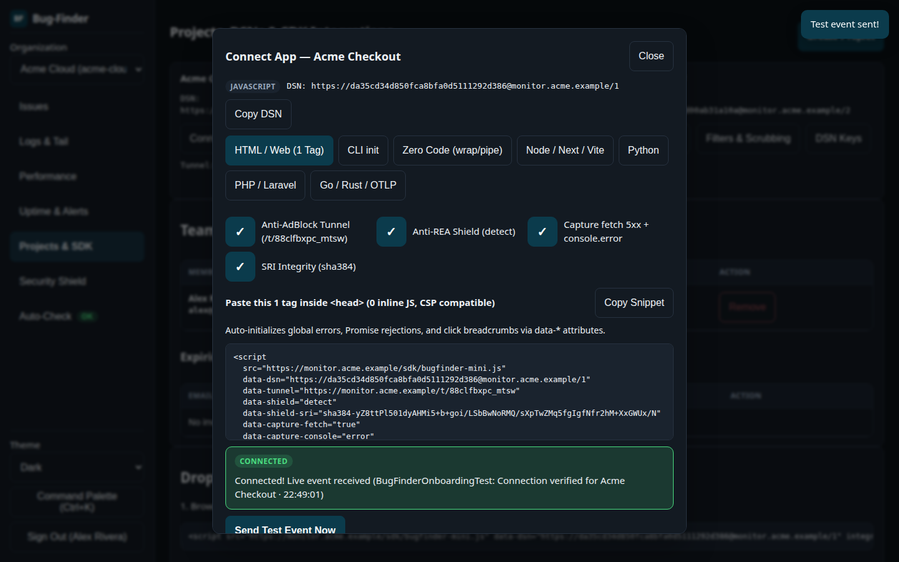
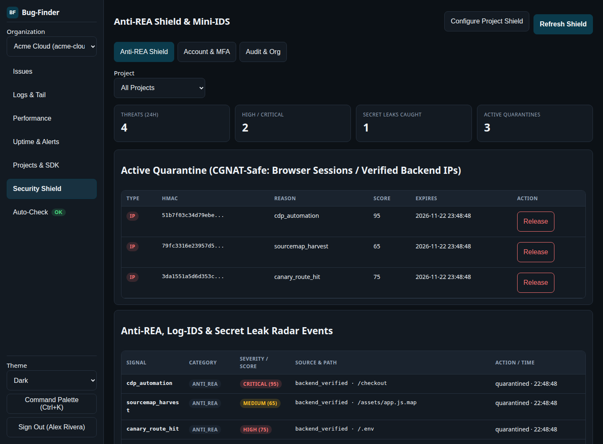

# Bug-Finder

[](Cargo.toml)
[](#measured-benchmarks-empirical-single-host-comparison)
[](#quickstart)
[](#connect-any-app-with-1-ai-prompt)
[](docs/ENDPOINTS_AND_SECURITY.md)
[](LICENSE)

**Pure-Rust, zero-Python observability and active runtime defense server** for error tracking, distributed tracing, structured logs, private SourceMaps, uptime heartbeats, and `< 1 µs` SIMD Layer-7 attack protection. Compiled into a single **~6.5 MB** executable running at **~8–11 MB VmRSS**, with drop-in compatibility for **Sentry SDKs**, **GlitchTip clients**, and **OpenTelemetry OTLP/HTTP**.


## Documentation Index

- [Architecture & Performance Pipeline](docs/ARCHITECTURE.md): Adaptive sub-millisecond `BatchWriter`, `ShardedBoundedMap` (16 shards), SIMD `AhoCorasick` WAF and Scrubber, SQLite WAL `mmap` + `prepare_cached`, and PostgreSQL 17 `FORCE RLS`.
- [1-Prompt Autonomous AI Integration](docs/AI_INTEGRATION.md): `/llms.txt`, `/api/0/projects/:org/:proj/ai-blueprint/`, `bugfinder ai-prompt`, same-origin `/_obs/*` stealth proxy routes, and STDIO MCP tools.
- [Endpoints & End-to-End Security](docs/ENDPOINTS_AND_SECURITY.md): Complete endpoint map, browser pre-wire URL scrubbing, RFC 9113 multi-header parsing, CSP `style-src-attr 'none'`, immutable `audit_logs` triggers, and `v2` anti-replay webhooks.
- [CLI & 7-Layer Verification Shell](docs/CLI_AND_CHECK_SHELL.md): Full CLI reference plus `bugfinder check` and `./scripts/check.sh`.

---

## What Bug-Finder v2.0 Covers

1. **Sub-Millisecond Error Tracking & Private SourceMaps**: Adaptive `BatchWriter` (`0 ms` idle flush, `5 ms` burst coalesce), immediate `< 0.2 ms` live SSE stream, FTS5 search, deterministic grouping & regression detection, root-cause diagnosis (`diagnose_issue` with `<untrusted_error_telemetry>` prompt-injection isolation), third-party widget filtering, and private SourceMap v3 VLQ demangling (`debug_id` + hashed bundle basename fallback + `bugfinder sourcemaps upload`).
2. **Structured Logs, OpenTelemetry OTLP & Trace Correlation**: Ingest Sentry `log` v2 envelopes, OTLP/HTTP (`application/x-protobuf` and JSON on `/v1/logs`), direct JSON logs, or terminal streams (`bugfinder wrap` / `pipe`), correlated via `trace_id`/`span_id` and same-origin `traceparent` propagation.
3. **1-Prompt Autonomous AI Integration**: Open **Connect App -> AI Auto-Setup (1-Prompt)** or run `bugfinder ai-prompt` (also published generically at `GET /llms.txt`) to generate one self-contained prompt containing every tracking, proxy, WAF, SourceMap, and MCP endpoint so your AI coding agent wires everything in one pass.
4. **7-Layer Verification Shell (`bugfinder check` & `./scripts/check.sh`)**: Verify server health, CSP, `/llms.txt`, error/session dry-probe ingest, OTLP log dry-probe, Shield + `ETag` blocklist, app HTML SDK/SRI tags, SourceMap zero-leak, and Edge WAF blocking in `< 250 ms`.
5. **Deterministic `< 1 µs` Rust SIMD Edge WAF & Secret Leak Radar**: Single-pass `AhoCorasick` URI/UA inspection (`SQLi`, 2-pass traversal, AWS/GCP/Oracle/Alibaba cloud metadata IPv4/IPv6 SSRF including `fd00:ec2::254`, `XSS`, `Command Injection`, `JNDI/SSTI`, `Prototype Pollution`, root dotfiles, `.js.map` scraping, WebDAV methods), CGNAT-safe `ShardedBoundedMap<[u8; 32], V, 16>` lockless-contention counters, and SIMD-prefiltered PII/credential scrubbing (`~15 ns` on clean strings) starting in the browser before transmission.
6. **Zero-Python Toolchain & Enterprise Cryptography**: Native `bugfinder lint` (`< 3 ms`) and `bugfinder keygen` eliminate Python dependencies in dev and CI; `100%` OS CSPRNG (`OsRng`) entropy, PostgreSQL 17 `ENABLE + FORCE ROW LEVEL SECURITY` (`NOBYPASSRLS`), `enc:v1:` AEAD secrets, database-enforced append-only `audit_logs` triggers, TOTP 2FA, WebAuthn Passkeys, and OIDC PKCE SSO.

---

## Measured Benchmarks (Empirical Single-Host Comparison)

Sequential baseline measured on `Ubuntu 24.04 Linux x86_64` (12 threads, `postgres:17-alpine`) with a 1.53 KB Sentry envelope across 50 rotating fingerprints (3 frames, 5 breadcrumbs):

| Metric | Bug-Finder (SQLite WAL) | Bug-Finder (PG17 `FORCE RLS`) | GlitchTip 7.0.0 (PG17, No-Valkey) |
|---|---|---|---|
| **Binary / Container Size** | **~6.5 MB single binary** | ~6.5 MB binary + PG | 953 MB app image + PG |
| **Idle App RAM (`VmRSS`)** | **8.8 – 9.6 MiB** | **9.5 MiB** | 162.3 MiB |
| **Total Stack RAM Post-Load (App + DB)** | **14.3 MiB** | **71.8 MiB** | 379.7 MiB |
| **Cold Start to HTTP `200 /api/health`** | **18.7 – 21.0 ms** | **56.7 ms** (`SKIP_MIGRATIONS=1`) | 5,114 ms *(excl. 22.1 s init)* |
| **Sequential Ingest (`100 x 1`)** | **907.9 req/s** (`p50 = 1.04 ms`) | **892.8 req/s** (`p50 = 1.12 ms`) | 203.9 req/s (`p50 = 4.88 ms`) |
| **Burst Ingest (`1,000 x 16` threads)** | **2,248 – 2,421 req/s** (`p50 = 5.8 ms`) | **2,208.9 req/s** (`p50 = 6.08 ms`) | 517.5 req/s (`p50 = 29.14 ms`) |
| **Issues List API Read (`200 x 8` threads)** | **2,020.3 req/s** (`p50 = 3.50 ms`) | **1,979.1 req/s** (`p50 = 3.62 ms`) | 9.7 req/s (`p50 = 725.5 ms`) |
| **Lint Invariants Check** | **< 3 ms** (`bugfinder lint`, 0 Python) | **< 3 ms** (`bugfinder lint`) | External scripts |

> **When to use GlitchTip vs Bug-Finder:** Choose **GlitchTip** for native C/C++/Rust minidump (`difs`) symbolication or S3/Parquet cold storage. Choose **Bug-Finder** for a **~10 MiB** single-binary runtime, **sub-25 ms** cold starts, strict PostgreSQL `FORCE RLS`, immutable audit logs, and built-in `< 1 µs` Rust SIMD Edge WAF without running Django, workers, or Redis/Valkey.

---

## Visual Tour

### Stack Traces, Root-Cause Diagnosis & Correlated Traces


### Structured Logs & Real-Time SSE Live Tail


### Connect App Wizard & 1-Prompt AI Auto-Setup


### Anti-REA Security Shield, Edge WAF & Secret Leak Radar


### Immutable SHA-256 Audit Chain, 2FA (TOTP) & WebAuthn Passkeys


### Built-In Auto-Check & Self-Diagnostics


---

## Connect Any App with 1 AI Prompt

Bug-Finder publishes `GET /llms.txt` publicly (zero cookies) and `GET /api/0/projects/:org/:proj/ai-blueprint/` per project so an AI coding assistant can wire everything in one step:

```bash
# 1. Print a complete, stack-aware 1-prompt brief pre-wired with every endpoint:
bugfinder ai-prompt \
  --dsn "https://<PUBLIC_KEY>@bugs.example.com/1" \
  --app-url "https://app.example.com" \
  --dir .

# 2. Let your AI assistant implement /_obs/* proxy, SDK/SRI tag, traceparent logs, Edge WAF, SourceMaps, and MCP.

# 3. Verify all 7 layers in one command (< 250 ms, zero phantom issues created):
bugfinder check \
  --dsn "https://<PUBLIC_KEY>@bugs.example.com/1" \
  --app-url "https://app.example.com"

# Or run the auto-.env shell wrapper:
./scripts/check.sh --app-url "https://app.example.com"
```

### All Endpoints Covered Automatically

| Purpose | Method & Path | Notes |
|---|---|---|
| Health & AI Spec | `GET /api/health`, `GET /llms.txt` | Cookie-free, strict security headers |
| Browser Mini-SDK | `GET /sdk/bugfinder-mini.js` | Pre-wire URL fragment/secret scrubbing, `visibilitychange` flush, optional same-origin `traceparent` |
| Anti-REA Shield SDK | `GET /sdk/bugfinder-shield.js` | CDP/WebDriver/tamper detection (`detect` / `defend` / `lockdown`) |
| Error & Session Ingest | `POST /api/:id/envelope/`, `POST /api/:id/store/` | Supports `X-BugFinder-Check: dry-probe` and timestamp skew clamping |
| Anti-AdBlock Tunnel | `POST /t/:slug` | Reverse-proxied via `/_obs/e` on the monitored app |
| Logs & Distributed Traces | `POST /api/:id/otlp/v1/logs`, `POST /v1/logs`, `POST /api/v1/logs` | OTLP JSON/Protobuf and direct JSON |
| CSP & Shield Telemetry | `POST /api/:id/security/`, `POST /api/:id/shield/` | Browser session quarantine or server `Bearer bf_...` IP quarantine |
| Edge Blocklist Sync | `GET /api/0/projects/:org/:proj/shield/blocklist/` | Cached via `ETag` (`304 Not Modified`), exposes per-project HMAC key |
| Private SourceMaps | `POST /api/0/projects/:org/:proj/releases/:version/sourcemaps/` | Zero public `.js.map` exposure |

---

## Quickstart

### 1. One-Command Installer (Binary, `systemd --user`, or Docker)

```bash
./scripts/install.sh            # Binary (~/.local/bin/bugfinder) + 0600 .env + bugfinder doctor
./scripts/install.sh --service  # Auto-starting user systemd unit (64 MB RAM cap)
./scripts/install.sh --docker   # Hardened Docker Compose deployment
```

### 2. Hardened Docker Compose (`64 MB` RAM Cap, Read-Only Rootfs)

```bash
docker compose up -d --build
```

`compose.yml` enforces `read_only: true`, `noexec,nosuid,nodev` on `/tmp`, `cap_drop: [ALL]`, `no-new-privileges:true`, and `pids_limit: 64`.

### 3. Manual Release Build & Verification

```bash
./scripts/build-release.sh
./target/release/bugfinder --headless --bind 127.0.0.1:8080 --data ./data
```

Use `--app` instead of `--headless` to launch Bug-Finder as a local desktop window. See [docs/CLI_AND_CHECK_SHELL.md](docs/CLI_AND_CHECK_SHELL.md) for all subcommands and flags.

---

## Environment Variables Reference

| Variable | Default | Description |
|---|---|---|
| `BUGFINDER_BIND` | `127.0.0.1:8080` | Bind `ip:port` (`127.0.0.1:0` in `--app` mode). |
| `BUGFINDER_DATA_DIR` | `./data` | Data directory (`0700`) for SQLite DB, `.app_key` (`0600`), and private SourceMaps. |
| `DATABASE_URL` | *(SQLite)* | Optional `postgres://...` / `postgresql://...` or `sqlite://...` URI. |
| `BUGFINDER_APP_KEY` | *(auto `.app_key`)* | 64-char hex master key (generate via `bugfinder keygen`). |
| `BUGFINDER_ENV` | `dev` on loopback / `production` otherwise | Set `production` or `dev`/`development`. |
| `BUGFINDER_PUBLIC_URL` | *(unset)* | Canonical public HTTPS origin for blueprints, Connect App, and OIDC callbacks. |
| `BUGFINDER_ALLOWED_HOSTS` | *(empty)* | Comma-separated allowed `Host` headers (wildcard `*` rejected). |
| `BUGFINDER_TRUSTED_PROXIES` | *(empty)* | Comma-separated CIDRs/IPs or presets `loopback`, `private`, `cloudflare` (no `*`). |
| `BUGFINDER_FORCE_SECURE_COOKIES` | `false` | Set `1`/`true` to always emit `Secure` on session cookies behind TLS proxies. |
| `BUGFINDER_SESSION_TTL_HOURS` | `168` | Absolute session lifetime (`1–720` hours). |
| `BUGFINDER_SESSION_IDLE_HOURS` | `24` | Sliding idle session timeout (`1–720` hours). |
| `BUGFINDER_MAX_UNZIPPED_BYTES` | `2097152` | Max decompressed ingestion payload (`4 KiB – 32 MiB`, default `2 MiB`). |
| `BUGFINDER_MAX_DB_MB` | `512` | Storage disk budget (`>= 16` MiB) before ingestion circuit breaker trips. |
| `BUGFINDER_RETENTION_DAYS` | `30` | Event/log/audit retention window (`1–3650` days). |
| `BUGFINDER_SKIP_MIGRATIONS` | `false` | Set `1`/`true` in production after running `bugfinder migrate`. |
| `BUGFINDER_ANTI_PTRACE` | `false` | Set `1`/`true` on Linux to set `PR_SET_DUMPABLE=0`. |
| `BUGFINDER_METRICS_TOKEN` | *(loopback only)* | Bearer token permitting remote Prometheus `GET /metrics` scraping. |
| `BUGFINDER_SMTP_HOST`, `_PORT`, `_TLS_MODE`, `_USER`, `_PASS`, `_FROM` | *(unset)* | Optional native Rust TLS SMTP alert relay (`587` STARTTLS / `465` implicit). |
| `BUGFINDER_OIDC_ISSUER`, `_CLIENT_ID`, `_CLIENT_SECRET`, `_DISPLAY_NAME` | *(unset)* | Optional OIDC SSO login (requires HTTPS `BUGFINDER_PUBLIC_URL` & issuer outside dev). |

---

## Development & Verification

```bash
# 1. Build embedded UI SPA + validate browser SDK & shell script syntax
npm --prefix ui ci && npm --prefix ui run build
node --check sdks/browser/bugfinder-mini.js
node --check sdks/browser/bugfinder-shield.js
bash -n scripts/check.sh scripts/install.sh scripts/build-release.sh

# 2. Run rustfmt, native Rust security invariant linter (< 3 ms), clippy, and full test suite
cargo fmt --all -- --check
cargo run -- lint --dir .
cargo clippy --all-targets --all-features -- -D warnings
cargo test --all-features
```
